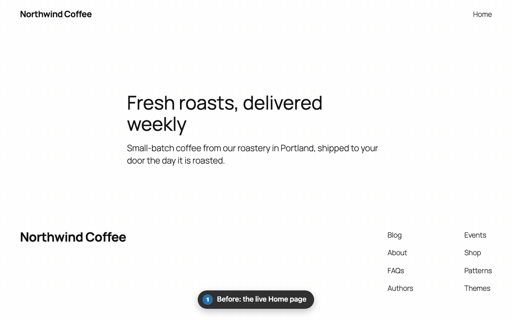
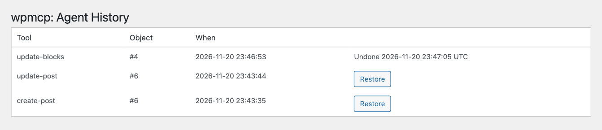

<div align="center">


# WordPress MCP Server Plugin (WP MCP)

WP MCP is a free WordPress MCP plugin that turns your site into an MCP server, so Claude, ChatGPT, Cursor and other AI agents can manage WordPress and WooCommerce, with undo for every supported write.

Built for site owners, agencies and developers who want an AI agent working on a live WordPress site without the risk of an edit they cannot take back.

[Docs](https://wpmcp-pro.com/docs) · [Integrations](https://wpmcp-pro.com/integrations) · [Changelog](https://wpmcp-pro.com/changelog) · [Pricing](https://wpmcp-pro.com/pricing) · [WooCommerce edition](https://github.com/wpmcp/wordpress-mcp-for-woocommerce)

[](https://github.com/wpmcp/wordpress-mcp/releases/latest)
[](https://github.com/wpmcp/wordpress-mcp/stargazers)
[](LICENSE)
[](https://php.net)
[](https://wordpress.org)

### [Download wpmcp.zip](https://github.com/wpmcp/wordpress-mcp/releases/latest/download/wpmcp.zip)

</div>

1. Download [wpmcp.zip](https://github.com/wpmcp/wordpress-mcp/releases/latest/download/wpmcp.zip).
2. In wp-admin, go to **Plugins > Add New > Upload Plugin**, choose the zip, click **Install Now**, then **Activate**.
3. Open **wpmcp > Connection** and connect Claude, ChatGPT or Cursor.

Requires WordPress 6.9+ and PHP 8.1+.

<p align="center">
  
</p>

> **WP MCP Pro, 10% off for GitHub users:** use code `WPMCPGIT` at [wpmcp-pro.com/pricing](https://wpmcp-pro.com/pricing?coupon=WPMCPGIT&utm_source=github&utm_medium=readme)

## What the WordPress MCP server does

**A WordPress AI agent with undo.** Every supported write is snapshotted before it runs, checked after, and rolled back on its own if the check fails. Undo one change or a whole agent session from the AI, or any single change with one click on the History screen in wp-admin. The free plugin keeps your last 20 undo points; Pro keeps unlimited history while the licence is active. The few things that cannot be undone are [listed](docs/reference/safety-model.md#what-cannot-be-undone), and each says so in its response.

**Build pages in Gutenberg, Elementor and other builders.** The free plugin reads and edits Gutenberg blocks, inserts patterns and converts HTML to blocks, verifying the markup after every edit. Pro adds Elementor MCP editing of the full element tree, plus Bricks, Divi, Beaver Builder, Breakdance, Oxygen, WPBakery, Avada and other builders. [Builder details](docs/reference/page-builders.md).

**Run the site.** Posts, pages, media, menus, users, settings, plugins and themes, plus cache clearing, performance and security scans and backups. Risky tools (raw database writes, file edits, package updates, code execution) ship switched off until you opt in.

**Run your store as a WooCommerce MCP server.** Products and variations, bulk price changes, orders, coupons and stock, each write undoable. Pro adds WooCommerce Subscriptions, Bookings and Memberships. Prefer a store-only build? See the [WooCommerce edition](https://github.com/wpmcp/wordpress-mcp-for-woocommerce).

**Works with your plugins.** Integrations for ACF, Yoast SEO and Rank Math, form, LMS, membership and other plugins register only while that plugin is active, so your AI client sees tools for what your site actually runs. Built on the WordPress Abilities API and the official WordPress MCP Adapter. [All integrations](https://wpmcp-pro.com/integrations).

<p align="center">
  
</p>

## How undo works

```
snapshot (before)  ->  apply the change  ->  verify  ->  ok?
     |                                          |         |
 stored by                              on failure:    return
 operation and                          auto-rollback   operation id
 agent session                          + raise error
```

Snapshots are taken at the WordPress data layer (post content, meta, terms, options, users), so rollback works the same for every page builder.
Each write returns an operation id: `rollback-operation` undoes one, `rollback-session` unwinds a whole agent run, and the History screen restores any single operation with one click.
Free keeps the last 20 operations; Pro keeps every one while the licence is active. Read the full list of [what cannot be undone](docs/reference/safety-model.md#what-cannot-be-undone).

## Connect your AI client: Claude Code, Claude Desktop, ChatGPT, Cursor

Open **wpmcp > Connection** in wp-admin. It creates an application password and shows the config for your client, filled in and ready to paste (Claude Desktop gets a one-click `wpmcp.mcpb` bundle). The endpoint is `https://your-site.com/wp-json/mcp/wpmcp-server`.

Step-by-step guides: [Claude Desktop and claude.ai](https://wpmcp-pro.com/wordpress-mcp-claude) · [Claude Code](https://wpmcp-pro.com/wordpress-mcp-claude-code) · [ChatGPT](https://wpmcp-pro.com/wordpress-mcp-chatgpt) · [Cursor](https://wpmcp-pro.com/wordpress-mcp-cursor) · [All clients](https://wpmcp-pro.com/docs/connecting-clients)

Stuck? Each guide ends with the common snags, and [Verifying the connection](https://wpmcp-pro.com/docs/connecting-clients#verifying-the-connection) shows how to check it end to end. OAuth sign-in (custom connectors, ChatGPT) is off by default; the [client reference](docs/reference/connecting-clients.md) covers it.

## Sample prompts

Paste-once blueprints in [prompts/](prompts/), each ending with an undo step:

- [Claude WordPress prompt: rebuild a homepage hero with undo](prompts/claude-wordpress-homepage-hero-with-undo.md)
- [WordPress AI agent prompt: bulk-fix SEO titles, then review in History](prompts/wordpress-ai-agent-bulk-seo-titles.md)
- [WooCommerce MCP prompt: update prices with a one-step rollback](prompts/woocommerce-mcp-price-update-with-rollback.md)
- [WordPress MCP prompt: build a Gutenberg landing page, then undo it](prompts/gutenberg-landing-page-wordpress-mcp.md)

## Free vs Pro

The free plugin is complete on its own: the safety engine and undo, Gutenberg editing, site management and the WooCommerce store tools.
Pro unlocks in the same plugin when you add a licence: unlimited undo history, Elementor deep editing, the other page builders, WooCommerce Subscriptions, Bookings and Memberships, agent project memory and priority support.
There is nothing else to install. Plans are on the [pricing page](https://wpmcp-pro.com/pricing), and the detail is in [Free vs Pro](docs/reference/free-vs-pro.md).

## Developer docs

Building on WP MCP or wiring it into your own agent? The full tool and protocol reference is in [docs/reference/](docs/reference/README.md). Guides for site owners are at [wpmcp-pro.com/docs](https://wpmcp-pro.com/docs).

## Contributing

Issues and pull requests are welcome. See [CONTRIBUTING.md](CONTRIBUTING.md), or open an issue to talk through a larger change first.

## Security

WP MCP edits live sites on an agent's instructions, so every admin action is capability-checked and nonce-protected, output is escaped and database access is parameterized. Found a vulnerability? Please open a private security advisory rather than a public issue.

## License

[GPL-2.0-or-later](LICENSE). Study it, fork it, ship it. If it saves you a rollback, [star it on GitHub](https://github.com/wpmcp/wordpress-mcp) so other WordPress builders can find it.
